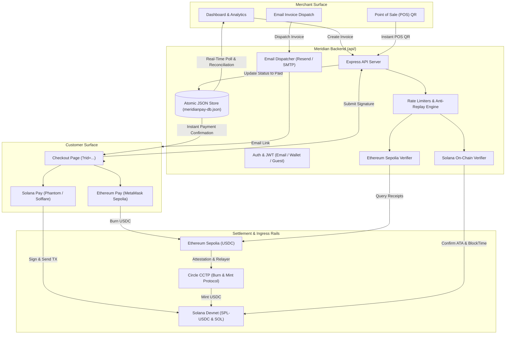
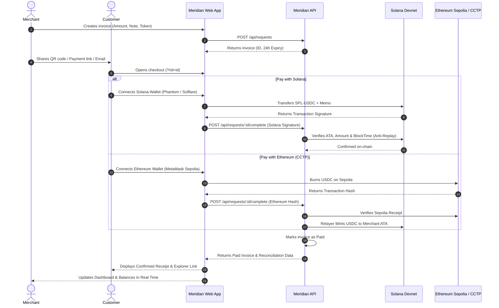

# Meridian Pay

> **Chain-Agnostic USDC Checkout & POS Terminal, Settled on Solana**

Meridian Pay is a non-custodial crypto payment gateway and Point-of-Sale (POS) terminal. It enables merchants to accept digital dollar payments from customers regardless of which blockchain they hold funds on. Solana serves as the high-speed, sub-cent settlement engine, while Ethereum acts as an ingress rail powered by Circle's Cross-Chain Transfer Protocol (CCTP).

---

## Architecture Overview



---

## Payment Lifecycle & Verification Flow



---

## Key Features

### 1. Dual-Rail Checkout
- **Solana Rail**: Native SPL-USDC transfer and SOL payments using `@solana/web3.js` and `@solana/spl-token`. Includes automatic Associated Token Account (ATA) creation for first-time recipients and SPL Memo program tagging.
- **Ethereum Rail (CCTP)**: Ingress pipeline for Ethereum Sepolia USDC via Circle Cross-Chain Transfer Protocol (CCTP) burn-and-mint mechanics.

### 2. Trustless Backend On-Chain Verification
The backend does not rely on client-side confirmation flags:
- Queries finalized Solana Devnet transactions directly via RPC.
- Inspects top-level and inner instruction sets to ensure the recipient ATA received the exact invoice amount.
- **Anti-Replay Protection**: Verifies the transaction's on-chain `blockTime` against the invoice `created_at` timestamp and enforces global signature deduplication to prevent replay attacks.
- Multi-RPC Ethereum Sepolia receipt verification.

### 3. Merchant Dashboard & Point-of-Sale (POS)
- **Live Balances**: Real-time devnet SOL and SPL-USDC balance monitors.
- **Financial Metrics**: Today's volume, all-time volume, Average Order Value (AOV), and Stripe processing fee savings calculator (2.9% + $0.30 comparison).
- **Quick POS Terminal**: Instant dynamic QR code generator for in-person payments.
- **Reconciliation Drawer**: Click-to-expand details showing explorer links, timestamps, and payment rails.
- **Data Export**: One-click export to CSV and JSON.

### 4. Hybrid Authentication
- **Email & Password**: Secure salted hashing via `bcryptjs` and session tokens via JWT.
- **Solana Wallet SSO**: 1-click authentication and automated account provisioning with Phantom, Solflare, or Backpack.
- **1-Click Demo Guest Mode**: Instantly loads the terminal pre-populated with realistic invoices and transaction records for demonstration and judging.

### 5. Automated Customer Invoicing
- Direct email invoice dispatching with styled HTML templates.
- Supports Resend API, custom SMTP (Gmail, AWS SES, SendGrid), and development simulation fallbacks.

### 6. Developer Platform
- Webhook simulation and testing engine (`/api/webhooks/test`).
- Sliding-window rate limiters across auth, invoice creation, and payment verification endpoints.

---

## Tech Stack

| Domain | Technologies |
| :--- | :--- |
| **Blockchain** | Solana Web3.js (`@solana/web3.js`), SPL Token (`@solana/spl-token`), Solana Wallet Adapter, Viem, Circle CCTP, Circle Developer-Controlled Wallets SDK |
| **Frontend** | React 19, TypeScript, Vite, QRCode.react, Custom CSS Ledger Design System (Light/Dark mode) |
| **Backend** | Node.js (ESM), Express 5, JWT, BcryptJS, Nodemailer, Nanoid |
| **Persistence** | Atomic file-swapping JSON Store (`meridianpay-db.json`) with tenant isolation |
| **Dev Tools** | Google Antigravity IDE, Gemini (AI Pair Programming), Oxlint |

---

## Project Structure

```text
meridianpay/
├── api/                               Express 5 REST Backend
│   ├── scripts/
│   │   └── create-circle-wallet.js    Circle Wallets SDK provisioner
│   ├── src/
│   │   ├── auth.js                    JWT signing, verification & password hashing
│   │   ├── db.js                      Atomic JSON store with tenant isolation
│   │   ├── email.js                   Responsive HTML invoice email generator
│   │   ├── env.js                     Environment loader
│   │   ├── ethereum-verify.js         Ethereum Sepolia RPC verification
│   │   ├── server.js                  REST routes, rate limiters, security headers
│   │   └── solana-verify.js           Solana devnet SPL verification & anti-replay
│   ├── meridianpay-db.json            Persistent data file
│   ├── .env.example
│   └── package.json
├── web/                               React 19 + TypeScript Frontend (Vite)
│   ├── public/
│   ├── src/
│   │   ├── components/
│   │   │   ├── AccountModal.tsx       Merchant settlement settings & profile
│   │   │   ├── AuthLanding.tsx        Landing page with login/registration
│   │   │   ├── AuthModal.tsx          Modal auth interface
│   │   │   ├── CreatePaymentRequest.tsx Dedicated invoice creation form
│   │   │   ├── Dashboard.tsx          Merchant terminal, analytics & POS
│   │   │   ├── Icons.tsx              Custom SVG icon system
│   │   │   ├── LogoutModal.tsx        Sign-out confirmation
│   │   │   ├── PayRequest.tsx         Customer checkout & payment rails
│   │   │   └── WalletButton.tsx       Multi-wallet selector & switcher
│   │   ├── lib/
│   │   │   ├── api.ts                 Typed backend client with AbortControllers
│   │   │   ├── auth.ts                Token storage & user profile state
│   │   │   ├── AuthContext.tsx        Authentication context provider
│   │   │   ├── constants.ts           Devnet mints, address helpers & link builders
│   │   │   ├── payments.ts            Solana transaction builder & ATA check
│   │   │   ├── ThemeContext.tsx       Dark / Light theme state manager
│   │   │   └── useWalletData.ts       Live SOL & SPL-USDC balance fetcher
│   │   ├── App.tsx                    Root application layout & route dispatcher
│   │   ├── main.tsx                   Wallet adapter provider initialization
│   │   └── styles.css                 Complete CSS design system
│   ├── .npmrc                         Vercel & CI peer-dependency configuration
│   ├── vercel.json                    SPA rewrite rules for deployment
│   ├── vite.config.ts                 Polyfills & proxy configuration
│   └── package.json
└── README.md
```

---

## Getting Started Locally

### Prerequisites
- Node.js 18+ installed
- A Solana wallet (Phantom, Solflare, Backpack) set to **Solana Devnet**
- Devnet SOL (from any faucet or `solana airdrop 1`)
- Devnet USDC (from [Circle's Faucet](https://faucet.circle.com) selecting *Solana Devnet*)

### Installation

1. **Clone the repository:**
   ```bash
   git clone https://github.com/Sujayhs07/merdian_pay.git
   cd merdian_pay
   ```

2. **Start the Backend API:**
   ```bash
   cd api
   npm install
   npm run dev
   # Server listens at http://localhost:8787
   ```

3. **Start the Frontend Application (in a second terminal):**
   ```bash
   cd web
   npm install
   npm run dev
   # Frontend runs at http://localhost:5173
   ```

4. Open `http://localhost:5173` in your browser.

---

## Environment Variables

### Backend (`api/.env`)
```bash
PORT=8787
JWT_SECRET=meridianpay_secret_key_2026

# Optional: Circle Developer-Controlled Wallets (for automated CCTP relayer minting)
CIRCLE_API_KEY=
CIRCLE_ENTITY_SECRET=
CIRCLE_SOLANA_WALLET_ID=

# Optional: Email Delivery (Resend API or SMTP)
RESEND_API_KEY=
EMAIL_FROM=invoices@yourdomain.com
# Or SMTP:
# SMTP_HOST=smtp.gmail.com
# SMTP_PORT=587
# SMTP_USER=your_email@gmail.com
# SMTP_PASS=your_app_password
```

### Frontend (`web/.env`)
```bash
# In local development, leave empty to use the Vite proxy (/api -> http://localhost:8787)
# In production, set to your deployed backend URL:
VITE_API_URL=https://your-api.onrender.com
```

---

## Deployment

- **Backend (`api/`)**: Ready for deployment on [Render](https://render.com) or [Railway](https://railway.app). Set the root directory to `api`, build command to `npm install`, and start command to `npm start`.
- **Frontend (`web/`)**: Ready for deployment on [Vercel](https://vercel.com). Set the root directory to `web`, framework preset to `Vite`, and provide the `VITE_API_URL` environment variable.

---

## License

ISC License. Built for the Solana ecosystem.
